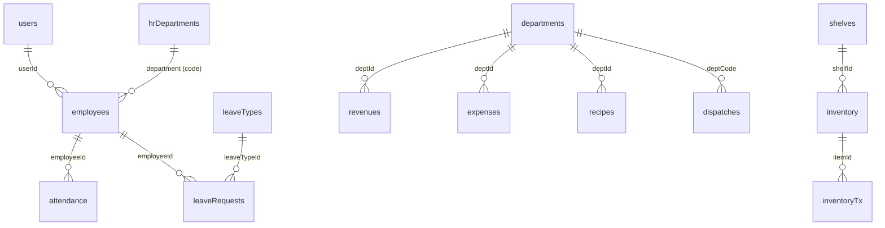

# مخطط قاعدة البيانات (Database Schema) لنظام karim ERP

## نظرة عامة
تم استخراج هذا المخطط من كائن `STATE` المركزي في تطبيق karim ERP لتصميم قاعدة بيانات PostgreSQL تدعم الشبكة المحلية، مع الحفاظ على تطابق تام في أسماء الحقول وأنواعها لضمان عمل الواجهة الأمامية بدون أي كسر. جميع المعرفات `id` سيتم تخزينها كـ `BIGINT` (لأنها مولدة من `Date.now()`) وستُعاد كأرقام `number` في الـ API.

## العلاقات بين الجداول (ERD)

## الجداول والتفاصيل

### 1. جدول `users` (المستخدمين)
| الحقل | النوع في JS | النوع في DB | ملاحظات |
|---|---|---|---|
| id | number | BIGINT | PRIMARY KEY |
| username | string | VARCHAR(255) | UNIQUE |
| password | string | VARCHAR(255) | نصي (غير مشفر حسب الطلب) |
| role | string | VARCHAR(50) | admin, warehouse, manager, kitchen, hr, employee |
| name | string | VARCHAR(255) | |
| active | boolean | BOOLEAN | DEFAULT true |

### 2. جدول `departments` (الأقسام)
| الحقل | النوع في JS | النوع في DB | ملاحظات |
|---|---|---|---|
| id | number | BIGINT | PRIMARY KEY |
| code | string | VARCHAR(50) | UNIQUE |
| name | string | VARCHAR(255) | |
| icon | string | VARCHAR(50) | |
| color | string | VARCHAR(50) | |

### 3. جدول `revenues` (الإيرادات)
| الحقل | النوع في JS | النوع في DB | ملاحظات |
|---|---|---|---|
| id | number | BIGINT | PRIMARY KEY |
| deptId | string | VARCHAR(50) | FOREIGN KEY (departments.code) |
| source | string | VARCHAR(255) | |
| amount | number | NUMERIC(10,2) | |
| date | string | DATE/VARCHAR(50) | |
| notes | string | TEXT | |

### 4. جدول `expenses` (المصاريف)
| الحقل | النوع في JS | النوع في DB | ملاحظات |
|---|---|---|---|
| id | number | BIGINT | PRIMARY KEY |
| deptId | string | VARCHAR(50) | FOREIGN KEY (departments.code) |
| desc | string | VARCHAR(255) | |
| amount | number | NUMERIC(10,2) | |
| date | string | DATE/VARCHAR(50) | |
| notes | string | TEXT | |
| autoGenerated | boolean | BOOLEAN | |

### 5. جدول `inventory` (المخزون)
| الحقل | النوع في JS | النوع في DB | ملاحظات |
|---|---|---|---|
| id | number | BIGINT | PRIMARY KEY |
| name | string | VARCHAR(255) | |
| category | string | VARCHAR(100) | |
| unit | string | VARCHAR(50) | |
| qty | number | NUMERIC(10,3) | |
| avgCost | number | NUMERIC(10,2) | |
| minQty | number | NUMERIC(10,3) | |
| shelfId | number | BIGINT | FOREIGN KEY (shelves.id) NULLABLE |
| weight | number | NUMERIC(10,3) | |

### 6. جدول `inventoryTx` (حركات المخزون)
| الحقل | النوع في JS | النوع في DB | ملاحظات |
|---|---|---|---|
| id | number | BIGINT | PRIMARY KEY |
| itemId | number | BIGINT | FOREIGN KEY (inventory.id) |
| itemName | string | VARCHAR(255) | |
| qty | number | NUMERIC(10,3) | |
| type | string | VARCHAR(50) | initial, in, out, return, bulk-import |
| date | string | VARCHAR(50) | |
| cost | number | NUMERIC(10,2) | |
| totalValue | number | NUMERIC(10,2) | |
| notes | string | TEXT | |
| invoiceNumber| string | VARCHAR(255) | NULLABLE |
| supplierName| string | VARCHAR(255) | NULLABLE |
| weight | number | NUMERIC(10,3) | NULLABLE |
| dispatchId| number/string| VARCHAR(255) | NULLABLE |

### 7. جدول `dispatches` (سجل الصرف)
| الحقل | النوع في JS | النوع في DB | ملاحظات |
|---|---|---|---|
| id | number | BIGINT | PRIMARY KEY |
| deptCode | string | VARCHAR(50) | FOREIGN KEY (departments.code) |
| deptName | string | VARCHAR(255) | |
| items | array | JSONB | مصفوفة الكائنات `{itemName, qty, unit}` |
| status | string | VARCHAR(50) | pending, approved, rejected |
| date | string | VARCHAR(50) | |
| createdBy | string | VARCHAR(100) | |
| notes | string | TEXT | |

### 8. جدول `recipes` (الوصفات)
| الحقل | النوع في JS | النوع في DB | ملاحظات |
|---|---|---|---|
| id | number | BIGINT | PRIMARY KEY |
| name | string | VARCHAR(255) | |
| deptId | string | VARCHAR(50) | FOREIGN KEY (departments.code) |
| sellingPrice| number | NUMERIC(10,2) | |
| totalCost | number | NUMERIC(10,2) | |
| costRatio | number | NUMERIC(10,2) | |

### 9. جدول `purchaseInvoices` (فواتير الشراء)
| الحقل | النوع في JS | النوع في DB | ملاحظات |
|---|---|---|---|
| id | number | BIGINT | PRIMARY KEY |
| invoiceNumber| string | VARCHAR(255) | |
| date | string | VARCHAR(50) | |
| supplierName| string | VARCHAR(255) | |
| supplierPhone| string | VARCHAR(50) | |
| items | array | JSONB | مصفوفة الأصناف في الفاتورة |
| totalAmount | number | NUMERIC(10,2) | |
| paymentMethod| string | VARCHAR(50) | cash, bank, credit |
| notes | string | TEXT | |
| createdAt | string | VARCHAR(50) | |
| createdBy | string | VARCHAR(100) | |

### 10. جدول `hrDepartments` (أقسام الموارد البشرية)
| الحقل | النوع في JS | النوع في DB | ملاحظات |
|---|---|---|---|
| id | number | BIGINT | PRIMARY KEY |
| name | string | VARCHAR(255) | |
| code | string | VARCHAR(50) | UNIQUE |
| manager | string | VARCHAR(255) | |

### 11. جدول `employees` (الموظفين)
| الحقل | النوع في JS | النوع في DB | ملاحظات |
|---|---|---|---|
| id | number | BIGINT | PRIMARY KEY |
| name | string | VARCHAR(255) | |
| employeeId | string | VARCHAR(50) | UNIQUE |
| department | string | VARCHAR(50) | FOREIGN KEY (hrDepartments.code) |
| position | string | VARCHAR(255) | |
| phone | string | VARCHAR(50) | |
| email | string | VARCHAR(255) | |
| joinDate | string | VARCHAR(50) | |
| salary | number | NUMERIC(10,2) | |
| status | string | VARCHAR(50) | active, inactive |
| userId | number | BIGINT | FOREIGN KEY (users.id) NULLABLE |
| iqamaExpiry | string | VARCHAR(50) | NULLABLE |
| healthCertExpiry| string | VARCHAR(50) | NULLABLE |
| photo | string | TEXT | Base64 Image (NULLABLE) |
| digitalFingerprint| string | VARCHAR(100) | |
| cardId | string | VARCHAR(100) | |

### 12. جدول `attendance` (الحضور والانصراف)
| الحقل | النوع في JS | النوع في DB | ملاحظات |
|---|---|---|---|
| id | number | BIGINT | PRIMARY KEY |
| employeeId | number | BIGINT | FOREIGN KEY (employees.id) |
| date | string | VARCHAR(50) | |
| checkIn | string | VARCHAR(50) | NULLABLE |
| checkOut | string | VARCHAR(50) | NULLABLE |
| late | boolean | BOOLEAN | |

### 13. جدول `leaveTypes` (أنواع الإجازات)
| الحقل | النوع في JS | النوع في DB | ملاحظات |
|---|---|---|---|
| id | number | BIGINT | PRIMARY KEY |
| name | string | VARCHAR(255) | |
| days | number | INT | |
| icon | string | VARCHAR(50) | |
| paid | boolean | BOOLEAN | |

### 14. جدول `leaveRequests` (طلبات الإجازات)
| الحقل | النوع في JS | النوع في DB | ملاحظات |
|---|---|---|---|
| id | number | BIGINT | PRIMARY KEY |
| employeeId | number | BIGINT | FOREIGN KEY (employees.id) |
| leaveTypeId| number | BIGINT | FOREIGN KEY (leaveTypes.id) |
| startDate | string | VARCHAR(50) | |
| endDate | string | VARCHAR(50) | |
| status | string | VARCHAR(50) | pending, approved, rejected |

### 15. جدول `shelves` (الرفوف)
| الحقل | النوع في JS | النوع في DB | ملاحظات |
|---|---|---|---|
| id | number | BIGINT | PRIMARY KEY |
| name | string | VARCHAR(255) | |
| code | string | VARCHAR(50) | |
| location | string | VARCHAR(255) | |
| capacity | number | NUMERIC(10,2) | |
| icon | string | VARCHAR(50) | |

### 16. جدول `settings` (الإعدادات)
| الحقل | النوع في JS | النوع في DB | ملاحظات |
|---|---|---|---|
| id | string | VARCHAR(50) | PRIMARY KEY (مثال: 'main_settings') |
| name | string | VARCHAR(255) | |
| logo | string | VARCHAR(100) | |
| logoB64 | string | TEXT | Base64 (NULLABLE) |
| currency | string | VARCHAR(50) | |
| lowStockAlert| boolean | BOOLEAN | |
| workStartHour| number | INT | |

### 17. جداول إضافية
- **`kitchenReturns`**: `id`, `date`, `items` (JSONB), `status`, `notes`
- **`payroll`**: `id`, `employeeId`, `month`, `year`, `basicSalary`, `netSalary`, `status`
- **`weightReadings`**: `id`, `weight`, `unit`, `date`, `itemId`
- **`notifications`**: `id`, `title`, `message`, `type`, `date`, `read`
